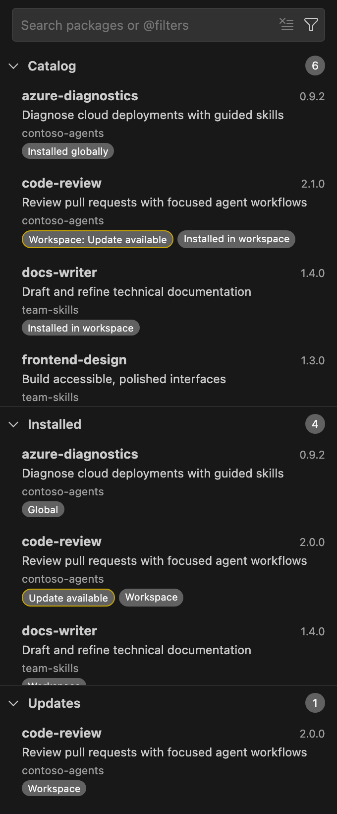

# APM for Visual Studio Code

Browse, install, and update AI agent packages without leaving VS Code.

APM for VS Code provides a visual interface for [Microsoft Agent Package Manager](https://microsoft.github.io/apm/), helping you manage skills, agents, instructions, prompts, and plugins for your coding tools.

This is an independent extension, not affiliated with or published by Microsoft.

## What you can do

- **Find packages:** browse marketplaces, search and filter packages, and explore their contents and documentation.
- **Manage installations:** install, update, or remove packages in your workspace or global user scope. Preview changes and choose specific versions.
- **Keep packages current:** see installed packages and available updates together, with separate workspace and global views.
- **Work with private repositories:** connect GitHub accounts or use securely stored, repository-scoped access tokens.
- **Manage APM projects:** initialize projects, edit manifests with completion and hover help, and run compilation, validation, and audits.
- **Explore more workflows:** inspect dependencies, export SBOMs, manage executable trust, check marketplace health, and discover MCP servers.

## Work your way

Most operations are available from more than one place:

| Where | What you can do there |
| --- | --- |
| **APM view** | Select the **APM** icon in the Activity Bar to browse and filter packages. Package pages offer install, preview, version, update, uninstall, audit, and dependency actions. |
| **Command Palette** | Run **APM:** commands to install packages, initialize, compile, validate, and audit projects, inspect dependencies, manage trust, and install MCP servers. |
| **Context menus** | Right-click a folder, `apm.yml`, or a deployed file in the Explorer or editor, or use the buttons above an open `apm.yml`. |
| **More APM Actions** | Open the view's **...** menu for one searchable list of dependency, trust, marketplace, MCP, and lifecycle workflows. |
| **Settings** | Configure marketplaces (`apm.marketplaces`), the CLI path (`apm.executablePath`), and APM configuration such as default targets and the MCP registry. Settings stay synchronized with APM. |
| **Tasks** | Run compile, watch, validate, audit, and opt-in manifest scripts with **Tasks: Run Task**. |

See [Commands](docs/commands.md) and [Settings](docs/settings.md) for the full lists.

## Get started

1. Install the extension and open a trusted workspace.
2. Select the **APM** icon in the Activity Bar.
3. If the view reports that the APM CLI is not available, choose **Install APM CLI**, or set `apm.executablePath` to an existing executable.
4. Browse the catalog. To add a marketplace, choose **Add marketplace** in the view, run **APM: Open Marketplace Settings**, or edit `apm.marketplaces`.
5. Select a package and choose **Install**, then pick a workspace or global destination and confirm.

For workspace installations, initialize the project first with **Initialize APM project** in the view or **APM: Initialize Project** if it has no APM manifest.

See [Getting started](docs/getting-started.md) for a detailed walkthrough.

## Private repositories

Run **APM: Sign in to GitHub** or **APM: Manage Repository Accounts** to connect an account or add a token. Grant organization SSO access if your repository requires it.

Tokens are stored in VS Code SecretStorage, not project files or settings. Background refresh never prompts you to sign in. Operations that need conflicting repository credentials may be blocked by APM's authentication limitations. See [Private repositories](docs/private-repositories.md).

## Requirements

- **VS Code 1.96 or later**, running on desktop or through Remote Development (SSH, WSL, or dev containers).
- **APM CLI**, installed on the host where the extension runs. The extension targets APM 0.35.0 and checks command compatibility.
- **Workspace Trust** before running APM or reading package sources.

Browser-only VS Code and virtual workspaces are not supported. Package changes require confirmation; APM handles package resolution and installation.

## Learn more

- [User guide](docs/user-guide.md): every workflow, with UI, command, and settings entry points.
- [Troubleshooting](docs/troubleshooting.md): recovery actions, diagnostics, and common problems.
- [APM, Now with a VS Code Interface | Antão Almada](https://antaoalmada.dev/posts/APM-Now-with-a-VS-Code-Interface/).
- [APM documentation](https://microsoft.github.io/apm/).
- [Report an issue](https://github.com/aalmada/agent-package-manager-extension/issues).
- [Contributing](CONTRIBUTING.md).
