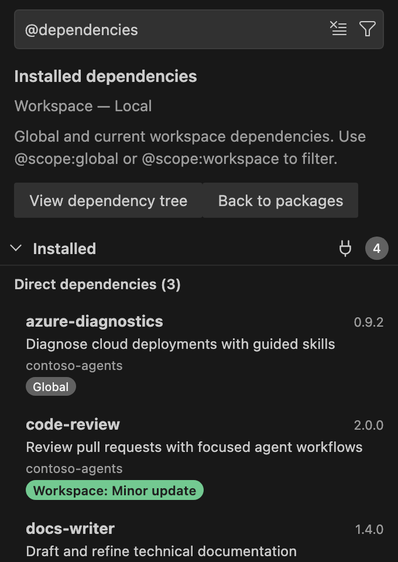
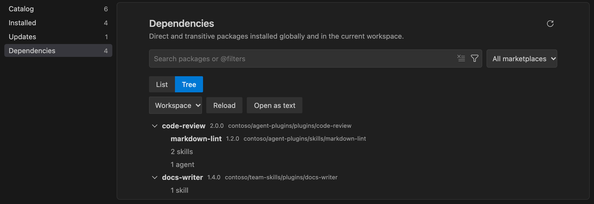

# Dependencies

Inspect what APM installed and why, trace deployed files back to their packages, and export dependency reports. All of these actions only read; the only one that writes is saving an SBOM to a file you choose.

## Current scope

Dependency actions use the view's current scope:

- By default, this is the first workspace folder, or **Global (user)** when no folder is open.
- In a multi-root workspace, choose **Scope** > **Workspace** in the filter menu to pick another folder.
- **View global dependencies** on a global package's page switches to the global scope; **View workspace dependencies** switches to that package's workspace folder.

## Browse dependencies

Dependency mode groups installed packages by how they were installed.

| Where | What to do |
| --- | --- |
| APM view | Choose **Dependencies** in the filter (funnel) menu, or type `@dependencies` in the search box. |
| [Package browser window](package-browser.md#package-browser-window) | Select **Dependencies** on the left. |
| Package page | Choose **View workspace dependencies** or **View global dependencies**. In the package browser window, this opens the **Dependencies** page. |

**Installed** then shows **Direct dependencies**, **Transitive dependencies**, and, when APM cannot classify an entry, **Unclassified dependencies**. Search, marketplace filters, sorting, scope filters, and package navigation keep working. Choose **Back to packages** to leave dependency mode. In the package browser window, the **Dependencies** page shows the same groups under **List**; select another page on the left to leave it.

## See why a package is installed

The extension reads the lockfile to find which installed packages require each transitive dependency:

- In the package browser window, transitive package cards show **Required by** and the parent packages.
- In the APM view, hover the **Transitive** badge.
- On a transitive package's page, **Transitive dependency required by** links to each parent's page. Update the parent to change the pinned version.

When a parent cannot be matched to an installed package, its lockfile key is shown without a link. For the full dependency paths, [explain the dependency](#explain-a-dependency).

## View the dependency tree

| Where | What to do |
| --- | --- |
| Package browser window | On the **Dependencies** page, choose **Tree**, then **Load dependency tree**. |
| APM view | In dependency mode, choose **View dependency tree**. |
| Command Palette | Run **APM: View Dependency Tree**. |
| More APM Actions | Choose **View Dependency Tree**. |

The extension runs `apm deps tree` (with `--global` for the global scope) only when you choose one of these actions; it never runs the tree report automatically. The package browser window shows the tree in place; the other actions open it in a read-only document.

### Tree in the package browser window

- Choose **Workspace** or **Global** to pick the scope. A `@scope:` filter limits the tree to that scope.
- Each package shows its name, version, and, when it differs from the name, APM's dependency key. Rows such as **2 skills** summarize a package's contents. **Circular** marks a dependency cycle, and **Not placed: run apm install** marks a dependency APM could not place in the tree.
- Search text and the marketplace filter keep matching packages and the packages that lead to them.
- Select an installed package, or press `Enter` or `Space`, to open its details in the window; **Back to packages** returns to the tree. Use `Up` and `Down` to move, `Right` and `Left` to expand, collapse, or move between parent and child, and `Home` and `End` to jump to the first or last row.
- **Reload** runs the report again. If installed packages change after loading, a notice asks you to reload.
- **Open as text** opens the loaded report in a read-only document without running APM again. When the window is modal, opening the document closes it.
- If APM fails or its output cannot be read, the page shows the error. Choose **Open as text** to review the output.

## Explain a dependency

| Where | What to do |
| --- | --- |
| Package page | Choose **Explain dependency** on an installed package. |
| Command Palette | Run **APM: Explain Dependency** and pick an installed dependency. |
| More APM Actions | Choose **Explain Dependency**. |

The extension runs `apm deps why --json` and opens the dependency paths in a read-only document.

## Find a file's owner

Find which APM package deployed a file in the project.

| Where | What to do |
| --- | --- |
| Explorer | Right-click a file and choose **APM: Find File Owner**. |
| Editor | Right-click in the editor and choose **APM: Find File Owner**. |
| Command Palette | Run **APM: Find File Owner** for the active editor's file. With no active file, the extension asks you to pick one. |
| More APM Actions | Choose **Find File Owner**. |

The extension runs `apm find` and opens the result in a read-only document. The file must be inside an APM project folder, and APM identifies only files it tracks.

## Dependency reports

Run **APM: Dependency Reports** from the Command Palette or **More APM Actions**, then choose a report:

| Report | What it does |
| --- | --- |
| **Check outdated dependencies (network)** | Runs `apm outdated` for the current scope. It uses the network and does not change cached update results in the view. |
| **View SBOM in editor** | Generates a CycloneDX JSON or SPDX JSON SBOM from the workspace or global lockfile and opens it in a read-only document. |
| **Save SBOM to file...** | Generates the same SBOM and saves it to a location you pick. The extension asks for confirmation (**Write SBOM**) before writing, then offers **Open SBOM**. |

Reports that exit with a nonzero code still open, together with a warning notification, so you can review the findings.
