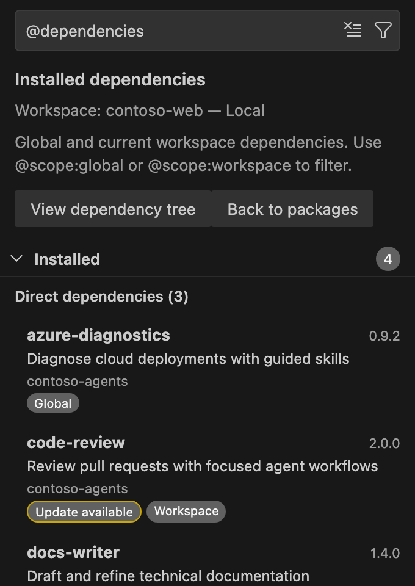

# Dependencies

Inspect what APM installed and why, trace deployed files back to their packages, and export dependency reports. All of these actions only read; the only one that writes is saving an SBOM to a file you choose.

## Current scope

Dependency actions use the view's current scope:

- By default, this is the first workspace folder, or **Global (user)** when no folder is open.
- In a multi-root workspace, choose **Scope** > **Workspace** in the filter menu to pick another folder.
- **View global dependencies** on a global package's page switches to the global scope; **View workspace dependencies** switches to that package's workspace folder.

## Browse dependencies

Dependency mode groups installed packages by how they were installed.

| Where | What to do |
| --- | --- |
| APM view | Choose **Dependencies** in the filter (funnel) menu, or type `@dependencies` in the search box. |
| Package page | Choose **View workspace dependencies** or **View global dependencies**. |

**Installed** then shows **Direct dependencies**, **Transitive dependencies**, and, when APM cannot classify an entry, **Unclassified dependencies**. Search, marketplace filters, sorting, scope filters, and package navigation keep working. Choose **Back to packages** to leave dependency mode.

## View the dependency tree

| Where | What to do |
| --- | --- |
| APM view | In dependency mode, choose **View dependency tree**. |
| Command Palette | Run **APM: View Dependency Tree**. |
| More APM Actions | Choose **View Dependency Tree**. |

The extension runs `apm deps tree` (with `--global` for the global scope) and opens the tree in a read-only document. It never runs the tree report automatically.

## Explain a dependency

| Where | What to do |
| --- | --- |
| Package page | Choose **Explain dependency** on an installed package. |
| Command Palette | Run **APM: Explain Dependency** and pick an installed dependency. |
| More APM Actions | Choose **Explain Dependency**. |

The extension runs `apm deps why --json` and opens the dependency paths in a read-only document.

## Find a file's owner

Find which APM package deployed a file in the project.

| Where | What to do |
| --- | --- |
| Explorer | Right-click a file and choose **APM: Find File Owner**. |
| Editor | Right-click in the editor and choose **APM: Find File Owner**. |
| Command Palette | Run **APM: Find File Owner** for the active editor's file. With no active file, the extension asks you to pick one. |
| More APM Actions | Choose **Find File Owner**. |

The extension runs `apm find` and opens the result in a read-only document. The file must be inside an APM project folder, and APM identifies only files it tracks.

## Dependency reports

Run **APM: Dependency Reports** from the Command Palette or **More APM Actions**, then choose a report:

| Report | What it does |
| --- | --- |
| **Check outdated dependencies (network)** | Runs `apm outdated` for the current scope. It uses the network and does not change cached update results in the view. |
| **View SBOM in editor** | Generates a CycloneDX JSON or SPDX JSON SBOM from the workspace or global lockfile and opens it in a read-only document. |
| **Save SBOM to file...** | Generates the same SBOM and saves it to a location you pick. The extension asks for confirmation (**Write SBOM**) before writing, then offers **Open SBOM**. |

Reports that exit with a nonzero code still open, together with a warning notification, so you can review the findings.
