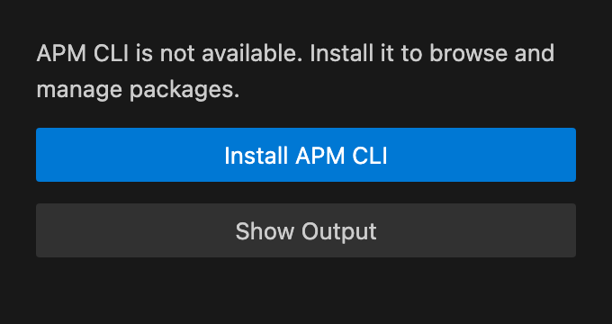
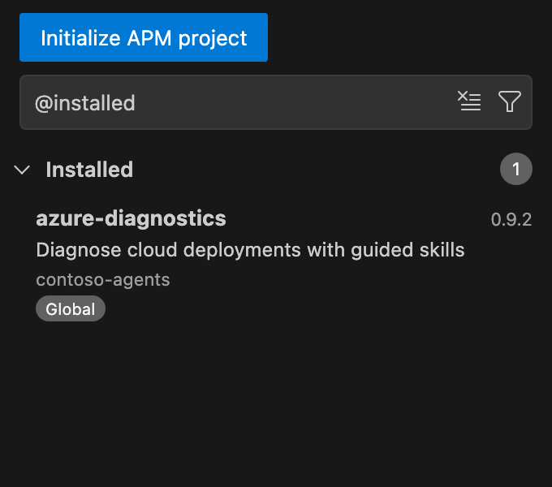

# Getting started

This page takes you from installing the extension to installing your first APM package. Each step can be done from the APM view, the Command Palette, or VS Code Settings; use whichever you prefer.

## Requirements

- **VS Code 1.96 or later**, on the desktop or through Remote Development (SSH, WSL, or dev containers). Browser-only VS Code and virtual workspaces are not supported because they cannot run the APM CLI.
- **The APM CLI** on the host where the extension runs. The extension does not bundle the CLI. It targets APM 0.35.0; see [APM version compatibility](troubleshooting.md#apm-version-compatibility).
- **A trusted workspace.** The extension does not run APM or read package sources until the workspace is trusted. See [Workspace Trust](security-and-trust.md#workspace-trust).

## Install the extension

1. Install [APM - Agent Package Manager](https://marketplace.visualstudio.com/items?itemName=antao-almada.apm-package-manager) from the Visual Studio Marketplace, or run **Extensions: Install from VSIX...** with a packaged build.
2. If you previously installed a development VSIX with the identifier `apm-local.apm-package-manager`, uninstall it first. Otherwise you get duplicate views and commands.

## Open the APM view

Select the **APM** icon in the Activity Bar to open the **Agent Package Manager** view. In an untrusted workspace, the view shows **Manage Workspace Trust** instead of package lists.

The [package browser](package-browser.md) page describes the view in detail.

## Set up the APM CLI

If the extension cannot find the APM CLI, the view shows a setup message instead of package lists.

| Where | What to do |
| --- | --- |
| APM view | Choose **Install APM CLI**. **Show Output** opens the APM output channel with the detection details. |
| Command Palette | Run **APM: Install or Upgrade CLI**. |
| Settings | Set `apm.executablePath` to the name or full path of an existing APM executable. |
| Terminal | Install APM yourself by following the [APM installation guide](https://microsoft.github.io/apm/getting-started/installation/), then choose **Refresh** in the view. |

The installer offers Homebrew (WinGet on Windows) or Python pip (Python 3.10 or later). When APM is already installed, it also offers `apm self-update` and pipx upgrades. **Show installation guide** opens the APM documentation instead. The installer asks for confirmation, then runs the chosen command in a terminal task.

## Add a marketplace

The catalog lists packages from the marketplaces registered with APM. The extension starts with the `netfabric/intelligentium` marketplace.

| Where | What to do |
| --- | --- |
| APM view | Choose **Add marketplace** when the catalog has no marketplaces, or open the **...** menu and choose **Settings**. |
| Command Palette | Run **APM: Open Marketplace Settings**. |
| Settings | Edit `apm.marketplaces`. |

Each change runs `apm marketplace add` or `apm marketplace remove`. See [Marketplaces](marketplaces.md) for the accepted source formats.

## Initialize a project

You can browse the catalog and install packages globally without a project. To install packages into the current workspace, it needs an `apm.yml` manifest. When the workspace has none, the view shows **Initialize APM project**.

| Where | What to do |
| --- | --- |
| APM view | Choose **Initialize APM project**. |
| Command Palette | Run **APM: Initialize Project**. |
| Explorer | Right-click a folder and choose **APM: Initialize Project**. |

See [Initialize a project](projects.md#initialize-a-project) for the steps.

## Install your first package

1. Select a package in the **Catalog** to open its page.
2. Choose **Install**.
3. Pick a destination: an initialized workspace folder or **Global (user)**.
4. Confirm the notification.

You can also run **APM: Install Package** from the Command Palette and enter a package source directly. See [Managing packages](managing-packages.md#install-a-package).

## Remote Development

The extension runs on the workspace host: the local machine, an SSH host, WSL, or a dev container. The APM CLI, local marketplace paths, and existing Git and SSH credentials must be available on that host. `apm.executablePath` can be set per remote in Remote Settings.

## Next steps

- [Package browser](package-browser.md): search, filter, and inspect packages.
- [Managing packages](managing-packages.md): install, preview, update, uninstall, and audit.
- [Private repositories](private-repositories.md): connect accounts and tokens.
