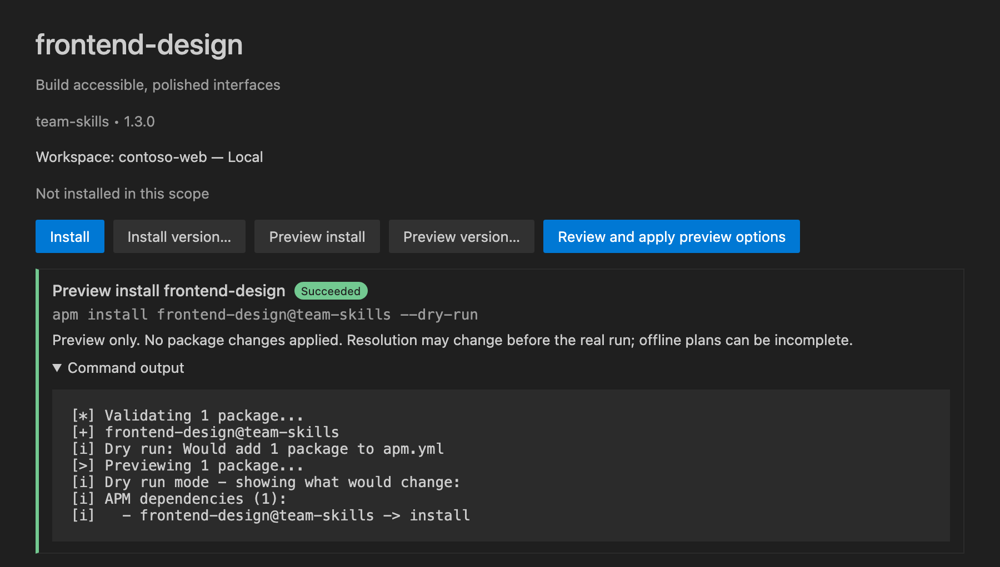
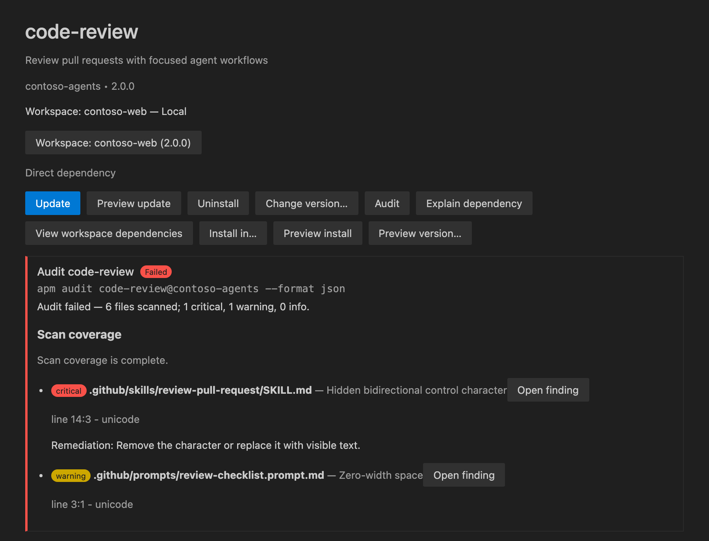

# Managing packages

Install, preview, update, uninstall, and audit APM packages from a package page or the Command Palette. APM resolves and changes packages; the extension collects your choices, asks for confirmation, and shows the results.

## Choose a destination

Packages can be installed in two scopes:

- **Workspace**: an initialized workspace folder with an `apm.yml` manifest. [Initialize a project](projects.md#initialize-a-project) first if the folder has none.
- **Global (user)**: your user-level APM installation, available without a workspace manifest.

Every install, install preview, and [MCP server installation](mcp-servers.md#install-an-mcp-server) asks for a destination first. The picker defaults to an initialized workspace when one is available, and to **Global (user)** otherwise. The view's scope filter does not choose the destination.

A package installed in both scopes appears as two separate entries, each with its own version, status, and actions. Once an operation starts, it keeps the scope it started with.

## Install a package

| Where | What to do |
| --- | --- |
| Package page | Select a catalog package, then choose **Install**. |
| APM view | Choose **Install a package** when **Installed** is empty. |
| Command Palette | Run **APM: Install Package**. |

**APM: Install Package** asks for:

1. The destination.
2. A catalog package, or **Enter package source...** to type a source such as `owner/repository` or `package@marketplace`.
3. Confirmation.

When installation finishes, choose **Open Package** in the notification to open the package page.

To install a package that is already installed in one scope into another, choose **Install in…** on its page. The page also links to each existing installation.

Installs leave target selection to APM and the project's `apm.yml`; the extension does not pass target overrides. To change the default targets, see [Deployment targets](projects.md#deployment-targets).

## Choose a version

- **Install version…** on a package that is not installed, or **Change version…** on an installed package, opens a version picker.
- The picker lists tags and branches reported by `apm view <package> versions`. Choose **Default** for the version pinned by the marketplace (or the default branch), or **Enter a ref…** to type a tag, branch, or commit SHA.

## Preview changes

Preview an operation before changing files. Previews run APM with `--dry-run` and show the plan on the package page.

| Button | Previews |
| --- | --- |
| **Preview install** | Installing the default version. |
| **Preview version…** | Installing a version or ref you pick. |
| **Preview update** | Updating an outdated installation. |

After a successful preview, **Review and apply preview options** runs the same operation without `--dry-run`. It still asks for confirmation.

APM's dry-run output is a plan, not a file-by-file diff. Offline plans can be incomplete, and resolution can change before you apply them.

## Update a package

| Where | What to do |
| --- | --- |
| Package page | Choose **Update**. It appears when an update is available. |
| APM view | Find outdated packages in **Updates**, or filter with `@updates`. |

Packages pinned to a tag move to the latest tag reported by APM. The extension runs `apm install <package>#<tag>` to change the manifest pin. Other packages use `apm update`.

After updating, the extension checks the refreshed package status. It reports an unverified or still-outdated result instead of assuming that a successful exit means the package was upgraded.

## Uninstall a package

Choose **Uninstall** on the package page. The package is removed from the scope shown on the page only.

## Confirmations and progress

Install, update, and uninstall ask for confirmation in a non-modal notification. The message names the scope, the execution host, and the risk: APM may write manifests and deployed files or run package scripts. Choose **Install**, **Update**, or **Uninstall** to proceed; dismissing the notification makes no changes.

While an action runs, the package page shows progress and a **Cancel** button. When it finishes, the page shows a summary, any audit findings, and APM's output. Full logs are in the **APM** output channel.

## MCP server values

If a package configures an MCP server that needs a value, such as an API key, VS Code asks for it in an input box. Answers are hidden as you type, and verbatim echoes are redacted from captured output. Values already set as environment variables are used without asking.

## Audit a package

Choose **Audit** on the page of a package installed in a workspace. APM audits scan a project, so global installations cannot be audited.

- The summary counts scanned files and findings by severity.
- **Scan coverage** states whether the scan was complete and lists incomplete-scan diagnostics separately from findings. Incomplete coverage is never shown as a clean audit.
- Each finding shows its severity, file, message, location, category, and remediation when available. Choose **Open finding** to go to the source.
- Findings inside decoded structured prompts open a read-only decoded document instead of pointing at the wrong physical source line.
- **Command output** contains APM's raw output.

To audit the whole workspace and publish findings to the **Problems** panel, see [Audit the workspace](projects.md#audit-the-workspace).

## Other package actions

- **Explain dependency** shows why APM installed the package. See [Explain a dependency](dependencies.md#explain-a-dependency).
- **View workspace dependencies** or **View global dependencies** switches the view to [dependency mode](dependencies.md#browse-dependencies).
