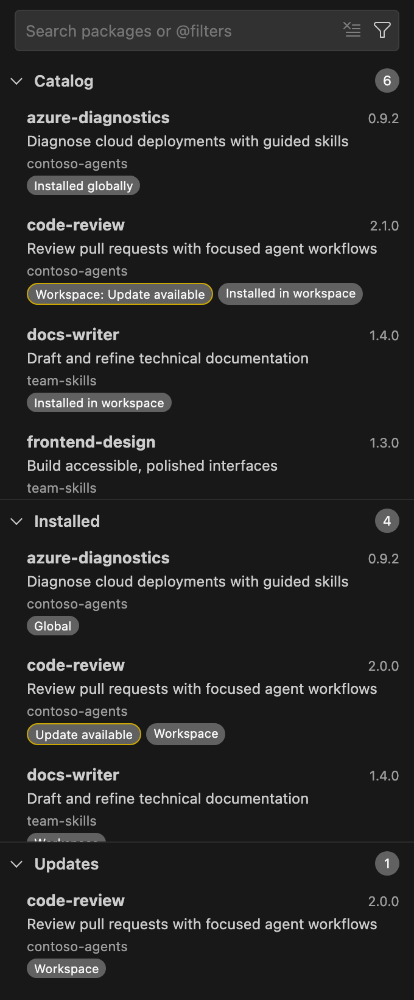
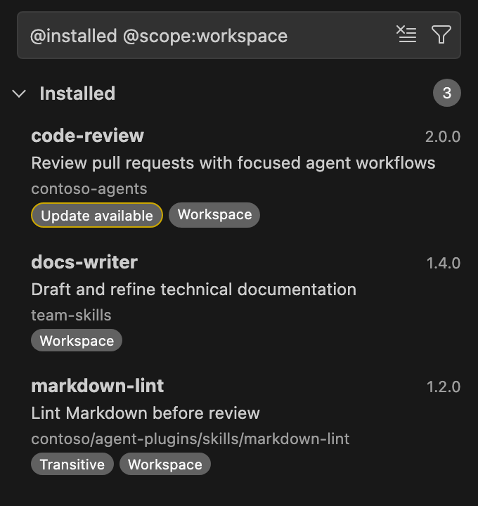
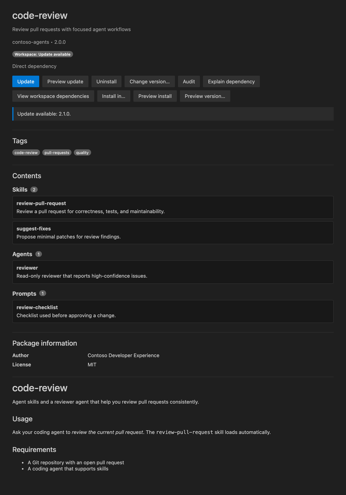

# Package browser

The **Agent Package Manager** view is the visual home of the extension. Select the **APM** icon in the Activity Bar to open it. It shows the packages in your marketplaces, the packages installed in the current workspace and your global user scope, and the updates available for them.

## Layout

- The search box and filter (funnel) button stay fixed at the top while the lists scroll.
- **Catalog** lists packages from your registered [marketplaces](marketplaces.md).
- **Installed** lists packages installed in the current workspace and in your global user scope.
- **Updates** lists installed packages that have a newer version.

Each section has a collapsible header with a right-aligned count of the items that match the current search. To resize sections, drag the separators between them, or focus a separator and use the arrow keys. Section sizes and collapsed state are saved.

## View toolbar

The top-right toolbar of the view has:

- **Refresh**: reload packages and check marketplaces and updates now.
- The **...** menu:
  - **Views**: show or hide **Catalog**, **Installed**, and **Updates**. Visibility is saved per workspace and is independent of search filters.
  - **Settings**: open the extension's settings in the Settings editor. See [Settings](settings.md).
  - **APM: More APM Actions**: open the **More APM Actions** picker of dependency, trust, marketplace, MCP, and lifecycle workflows. It appears only in trusted workspaces. See [Commands](commands.md#more-apm-actions).

**Refresh** and **Settings** are available only from this toolbar, not from the Command Palette.

## Search and filters

Type in the search box to match package names, descriptions, and marketplaces. To narrow the lists, choose an option in the filter (funnel) menu or type an `@` token in the search box; the menu inserts the same tokens. Combine tokens with text, and choose **Clear** to reset the search. **Installed**, **Updates**, and **Dependencies** are mutually exclusive; choosing one replaces the others.

| Filter | Funnel menu | Search token |
| --- | --- | --- |
| Installed packages only | **Installed** | `@installed` |
| Packages with updates | **Updates** | `@updates` |
| [Dependency mode](dependencies.md#browse-dependencies) | **Dependencies** | `@dependencies` |
| Workspace or global scope | **Scope** > **Workspace** or **Global (user)**; **All Scopes** clears it | `@scope:workspace` or `@scope:global` |
| One marketplace | **Marketplace** > **Choose Marketplace...**; **All Marketplaces** clears it | `@marketplace:<name>` |
| Sort order | **Sort By** > **Name (A-Z)**, **Name (Z-A)**, or **Marketplace** | `@sort:name`, `@sort:name-desc`, or `@sort:marketplace` |

Choosing the active scope again clears the scope filter. In a multi-root workspace, choosing **Workspace** also selects the current folder. Scope filters only change what you see; installing always asks for a destination separately.

## Badges

Package lists and details pages use the same scope/status badges. An update or update-check status implies the package is installed in that scope, so the scope is never repeated:

| Section | Up to date | Newer version available |
| --- | --- | --- |
| **Catalog** and package details | **Workspace: Installed**, **Global: Installed** | **Workspace: Update available**, **Global: Update available** |
| **Installed** | **Workspace**, **Global** | **Workspace: Update available**, **Global: Update available** |
| **Updates** | | **Workspace**, **Global** |

A package installed in both scopes has two badges in **Catalog**, and a separate entry for each scope in **Installed** and **Updates**. When a scope filter is active, **Catalog** shows only the badge for that scope. Update status is conveyed by text, not an extra border.

Direct Git installations also appear as installed in **Catalog** when their repository and package subdirectory match a catalog entry. Matching does not rely on the package name alone. If exactly one marketplace lists that source, **Installed**, **Updates**, and package details show that marketplace name instead of the repository, and marketplace search, filter, and sort include the package. A source listed by several marketplaces keeps its repository label.

Marketplace labels always use the alias currently registered with APM, including a custom `name=` alias. If a package was installed through a marketplace alias that has since been renamed, it shows the new alias when exactly one marketplace lists its source. A different-case spelling of the alias also shows as the registered name. Updates and other operations still use the source or marketplace name recorded when the package was installed.

On package details pages, select a scope badge to view that installation. The active scope is bold, and hovering a badge shows its installed version. **Workspace** refers to the current workspace; badges omit the folder name.

The status part of a scope badge can also be:

| Status | Meaning |
| --- | --- |
| **Update available (cached)**, or **Cached** in **Updates** | The update result comes from an earlier check. |
| **Showing saved update status** | The latest update check failed, so the last known result is shown. |
| **Could not check for updates** | APM could not determine the update status. |
| **Version could not be compared** | APM could not compare the installed version with the latest one. |

Other badges:

| Badge | Meaning |
| --- | --- |
| **Transitive** | Installed as a dependency of another package, not declared directly. |
| **Cached catalog** | The marketplace could not be refreshed, so its last known entries are shown. |

The **APM** Activity Bar icon shows a badge with the number of global and workspace updates, regardless of search filters, plus one when the extension recommends a CLI upgrade. Its tooltip identifies results saved from an earlier check. The badge disappears when there are no updates, the CLI is unavailable, or the workspace is untrusted.

## Refresh and caching

- The view refreshes automatically when workspace or global manifests and lockfiles, the APM marketplace registry or configuration, extension settings, or accounts change.
- Automatic refreshes reload installed packages locally but reuse remote marketplace and update checks for five minutes, including failed checks. This reduces API rate-limit pressure.
- **Refresh** checks immediately. Changing accounts clears cached remote results, and installing, updating, or uninstalling forces a fresh update check for that scope.
- Refresh progress appears as VS Code's native view progress indicator. Repeated refresh warnings are shown once until they change or clear.

Catalog installation badges appear as soon as installed packages are loaded, without waiting for update checks. Comparing installed and catalog versions supplies the initial update status; APM's `apm outdated` check then refines it during the same refresh.

## Package details

Select a package to open its page in an editor tab. **Catalog**, **Installed**, and **Updates** open the same details tab for the same package and installation scope, including packages installed directly from a Git repository. Installed packages show their installed version, local contents, and update/uninstall actions regardless of which list you opened them from.

The page shows:

- Compact installation badges with the active scope marked, without a separate workspace-name line. Keyword tags from package metadata use the same badge style.
- **Actions** for the package in that scope. See [Managing packages](managing-packages.md).
- **Contents**: skills, agents, instructions, prompts, Copilot extensions, and other primitives. Items that exist locally open the verified file; items missing from local metadata are listed without a link.
- **Package information**: other metadata from the package manifest and APM, such as author, license, and repository.
- **README** and other available documentation. Remote images are blocked unless you enable `apm.allowRemoteImages`; see [Remote images](security-and-trust.md#remote-images).

For awesome-copilot plugins, APM installs only the plugin's manifest and README. The page resolves the contents declared for the published build from the repository and labels them.

The extension also recognizes standalone skills, skill bundles, and marketplace plugins recorded in the lockfile when the package cache is missing. It verifies deployed files locally, without repository authentication. A manifest entry, stale lock entry, or leftover files alone do not count as installed.
