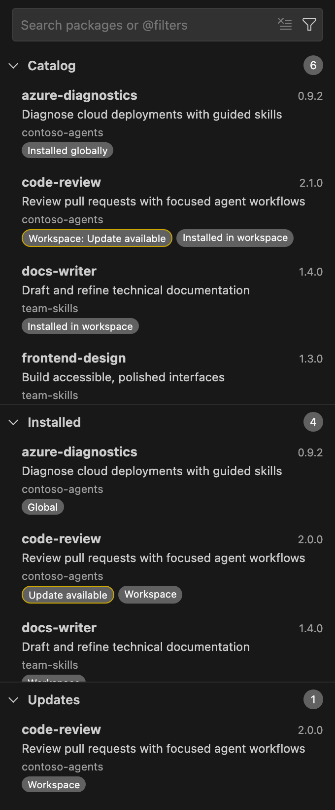

# APM user guide

APM for VS Code is a visual interface for [Microsoft Agent Package Manager](https://microsoft.github.io/apm/) (APM). Use it to browse, install, and update AI agent packages, such as skills, agents, instructions, prompts, and plugins, and to manage APM projects without leaving VS Code.

APM resolves and changes packages; the extension collects your choices, asks for confirmation, and shows the results. It covers common package and project operations, not the entire CLI: advanced registry publishing and other CLI-only operations remain in the terminal. This extension is independent and is not affiliated with or published by Microsoft.

## Ways to work

Most operations have more than one entry point. Use whichever fits your workflow:

| Entry point | Use it for |
| --- | --- |
| **APM view** | Select the **APM** icon in the Activity Bar to browse packages, filter them, and open package pages with install, preview, update, uninstall, and audit actions. |
| **View toolbar** | **Refresh**, and the **...** menu with **Views**, **Settings**, and **APM: More APM Actions**. |
| **Command Palette** | Run any **APM:** command, such as **APM: Install Package** or **APM: Compile**. See [Commands](commands.md). |
| **More APM Actions** | A searchable picker of dependency, trust, marketplace, MCP, and lifecycle workflows, in the view's **...** menu. |
| **Context menus and editor title** | Right-click a folder, `apm.yml`, or any file in the Explorer or editor, or use the buttons above an open `apm.yml`. |
| **Settings** | Configure the CLI path, marketplaces, scripts, remote images, and APM's own configuration. See [Settings](settings.md). |
| **Tasks** | Run compile, watch, validate, audit, and script workflows with **Tasks: Run Task**. See [Tasks and scripts](projects.md#tasks-and-scripts). |
| **Notifications** | Confirm changes and choose recovery actions such as **Show APM Output**, **Run Doctor**, or **Retry**. |

## Contents

- [Getting started](getting-started.md): requirements, installation, CLI setup, and your first package.
- [Package browser](package-browser.md): the view, search and filters, badges, refresh, and package pages.
- [Managing packages](managing-packages.md): install, choose versions, preview, update, uninstall, and audit.
- [Marketplaces](marketplaces.md): add marketplaces, source formats, and marketplace health checks.
- [APM projects](projects.md): initialize, edit manifests, compile, validate, audit, targets, tasks, and lifecycle scripts.
- [Dependencies](dependencies.md): dependency mode, the dependency tree, explanations, file owners, and SBOMs.
- [MCP servers](mcp-servers.md): discover and install MCP servers, and use a private registry.
- [Private repositories](private-repositories.md): GitHub accounts, tokens, enterprise hosts, and rate limits.
- [Security and trust](security-and-trust.md): Workspace Trust, confirmations, executable trust, and privacy.
- [Settings](settings.md): every setting and how it synchronizes with APM.
- [Commands](commands.md): every command and where to find it.
- [Troubleshooting](troubleshooting.md): recovery actions, diagnostics, and common problems.

## Find a task

| I want to... | In the APM view | Command Palette or menu | Setting |
| --- | --- | --- | --- |
| [Install the APM CLI](getting-started.md#set-up-the-apm-cli) | **Install APM CLI** | **APM: Install or Upgrade CLI** | `apm.executablePath` |
| [Add a marketplace](marketplaces.md#add-or-remove-a-marketplace) | **Add marketplace**, or **...** > **Settings** | **APM: Open Marketplace Settings** | `apm.marketplaces` |
| [Find a package](package-browser.md#search-and-filters) | Search box and filter (funnel) menu | | |
| [Install a package](managing-packages.md#install-a-package) | **Install** on a package page | **APM: Install Package** | `apm.config.target` for default targets |
| [Preview a change](managing-packages.md#preview-changes) | **Preview install**, **Preview version…**, **Preview update** | | |
| [Update a package](managing-packages.md#update-a-package) | **Updates** section; **Update** on a package page | | |
| [Audit a package or workspace](managing-packages.md#audit-a-package) | **Audit** on a package page | **APM: Audit Workspace**; `apm.yml` Explorer context menu; `audit` task | |
| [Initialize a project](projects.md#initialize-a-project) | **Initialize APM project** | **APM: Initialize Project**; Explorer folder context menu | |
| [Compile or validate](projects.md#compile-preview-and-validate) | | **APM: Compile**, **APM: Preview Compilation**, **APM: Validate Manifest and Primitives**; `apm.yml` editor title; tasks | `apm.config.autoIntegrate` |
| [Run manifest scripts](projects.md#manifest-scripts) | | **APM: Run Script**; **Tasks: Run Task** | `apm.tasks.includeScripts` |
| [Inspect dependencies](dependencies.md) | **Dependencies** filter; **View dependency tree**; **Explain dependency** | **APM: View Dependency Tree**, **APM: Explain Dependency**, **APM: Dependency Reports**; More APM Actions | |
| [Find which package deployed a file](dependencies.md#find-a-files-owner) | | **APM: Find File Owner**; Explorer and editor context menus | |
| [Install an MCP server](mcp-servers.md#install-an-mcp-server) | | **APM: Install MCP Server**; More APM Actions | `apm.config.mcpRegistryUrl` |
| [Approve or deny executables](security-and-trust.md#executable-trust-and-policy) | | **APM: Manage Executable Trust**; More APM Actions | |
| [Access a private repository](private-repositories.md) | | **APM: Sign in to GitHub**, **APM: Manage Repository Accounts** | |
| [Allow README images](security-and-trust.md#remote-images) | | | `apm.allowRemoteImages` |
| [Diagnose a problem](troubleshooting.md) | **Show Output** | **APM: Run Doctor**; error notification actions | |

## Learn more

- [APM documentation](https://microsoft.github.io/apm/)
- [APM, Now with a VS Code Interface](https://antaoalmada.dev/posts/APM-Now-with-a-VS-Code-Interface/), an introductory post
- [Report an issue](https://github.com/aalmada/agent-package-manager-extension/issues)
